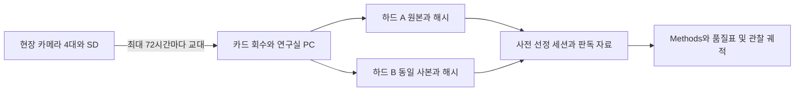

# 실험과 논문을 위한 통합 데이터 수집 계획

2026년 10월 15일 개정. **SoundWel 분석으로 첫 원고를 만들면서, 기존 사양시험에서는 후속 연구에 필요한 음영상과 관리 기록을 수집한다.** SoundWel은 공개 콜의 맥락 전이 연구이고, 농장은 연속 관측의 측정 가능성을 확인하는 파일럿이다. 두 자료를 하나의 감정 분류 데이터셋으로 합치지 않는다.

[시작](../README.md) · [8주 커리큘럼](../curriculum.md) · [SoundWel 통계 설계](context_transfer_design.md) · [데이터 사전](data_dictionary.md) · [빈 기록 양식](../templates/data_collection/README.md) · [진도](../progress.md)

이 문서는 전체 수집과 최신 농장 설계의 기준이다. SoundWel의 H1/H2·분할·모형은 10월 12일 프로토콜을 유지한다. 이전 문서의 한 돈방·18일 보존·외장 녹음기 안은 현재 현장 실행 기준으로 쓰지 않는다. 실제 수집일·농장 식별정보·원자료·저자 제공 ID표·미공개 결과는 `.local/` 또는 연구실 저장소에 둔다.

## 연구별 질문과 논문 산출물

| 연구 | 질문과 가설 | 수집하거나 정리할 자료 | 논문에서 맡을 역할 |
|---|---|---|---|
| A 우선 원고 | 같은 평가 콜에서 학습 맥락이 바뀌면 성능이 얼마나 달라지는가? H1은 K4−U4, H2는 특징 추가 효과의 K/U 차이 | 기존 SoundWel·Key·S1·특징, 원 맥락과 동복 근거, 고정 분할, 실행 로그·OOF 예측 | 공개자료의 탐색적 맥락 전이 재분석. 첫 2주 내부 검토본, 6~8주 원고 검토 목표 |
| B 농장 파일럿 | Tapo만으로 급이 전후의 음영상 자료를 얼마나 안정적으로 기록·회수·동기화·판독할 수 있는가? | SD 원본, 실제 급이·사양 단계·장치·관리 기록, 행동 스캔·음향 사건 | 측정 가능성 보고와 후속 연구 준비. 독립 논문이 될지는 실제 기여로 판단 |
| B 탐색 질문 | 급이 후 급이기 점유가 전보다 높아지는가? 녹음된 발성 활동은 행동 변화와 함께 변하는가? | 사전에 정한 세 관찰창과 유효시간, 가시 두수, 발성 출처·잡음·이웃 급이 | 방향이 반대여도 보고하는 기술적 궤적. 사료 단계별 변화는 추가 탐색 |
| C 후속 검증 | 독립 돈방·배치에서도 측정값이 반복되고 생산성 또는 별도 회복 기준과 연결되는가? | B에서 정한 측정 정의, 독립 반복과 외부 기준을 갖춘 새 자료 | B 이후 별도 설계. 현재 60두·여러 날로 처리 반복을 대체하지 않음 |

[Lee 2024](https://doi.org/10.1016/j.applanim.2024.106243)에서는 서로 다른 스트레스 상황의 반응 지표가 같은 특성을 나타내는지라는 문제를 가져온다. SoundWel의 맥락 라벨, 급이 반응, 보상성장, 생리적 회복탄력성을 같은 정답으로 취급하지 않는다. 세 개의 짧은 관찰창으로 행동 회복 시간을 계산하지 않는다.

## 현재 준비 상태와 다음 작업

| 항목 | 현재 확인 상태 | 다음 작업 |
|---|---|---|
| 공개자료 | Zenodo ZIP·Key와 저자 S1 확보. 공식 설명은 6,888콜, 체크섬이 맞는 로컬 인벤토리와 Key는 6,887 | 설명과 파일 수의 차이를 출처 대장에 기록. 임의의 1콜 제외 사유를 만들지 않음 |
| SoundWel 후보 | IASPA LF 1,648콜, 공통 평가 후보 542콜. 평가 양성 5동복·음성 16동복 | S1 조인·alias·원 녹음 관계와 적격성을 최종 감사 |
| 잠정 분할 | 5-fold manifest 1,562 역할행. test 542 + train 1,020. CV 학습 역할행은 새 표본 수가 아님 | 기존 manifest를 재사용하되 최종 연결 감사 후 버전·해시 고정 |
| 음원 감사 | 10월 12일에 후보 WAV 1,648개 읽기 성공, byte/PCM 완전 동일 복제 없음 | 부분 중복·같은 긴 원 녹음 가능성은 별도 확인. 확인 불가면 세션 독립 주장 제외 |
| 새 맥락 전이 분석 | 전용 실행기와 본 분석 20회는 미완료 | 기존 연구 엔진에 실행기 구현 → 개발 점검 4회 → 별도 본 분석 20회 |
| 농장 장비 | C320WS 2대 보유, 2대 추가 계획 | 보유 장비로 회수 방식 확인 후 최종 4대·카드 두 세트 검증 |
| 농장 원본 | 실제 Tapo SD 원본의 음질·파일 형식·저장량 검증 미실시 | 현장 72시간 시험. 기기 스펙 확인만으로 연구용 음질 검증 완료 처리하지 않음 |

위 숫자는 자료 준비 상태이며 모델 결과가 아니다. 저자 ID의 불확실성을 유지하고 과거 스모크 결과를 새 맥락 전이 실험의 검증 실적으로 사용하지 않는다.

## SoundWel 데이터 준비

원 ZIP·Key·S1·기존 특징을 정본으로 보존하고 새 다운로드나 특징 재계산부터 반복하지 않는다. [공개 SoundWel](https://zenodo.org/records/8252482)은 선별된 개별 발성 자료이므로 자연 발성률·침묵 길이·급이 전후 연속 행동을 복원할 수 없다. [Briefer 2022](https://pmc.ncbi.nlm.nih.gov/articles/PMC8901661/)와 공개 릴리스의 표본 범위를 구분한다.

1. **출처 고정:** 릴리스·URL·라이선스·파일명·바이트 수·공식 체크섬·로컬 SHA256·실제 행 수를 `sources`에 기록한다. S1의 접근·재배포 조건도 따로 기록한다.
2. **클립 대장:** WAV 읽기·포맷, 원 저자 ID와 맥락, 조인 상태, 동복·alias·원 녹음 근거, 네 특징·결측·제외 사유를 모은다. 원래 열을 보존하고 표준화 열을 추가한다. placeholder 날짜를 실제 세션으로 쓰지 않는다.
3. **분할 고정:** 확인된 동복·alias·공통 원 녹음의 연결을 같은 블록으로 둔다. 변경으로 블록이 합쳐지면 성능 실행 전에 코호트와 fold를 다시 정한다. 확인하지 못한 연결은 미확인으로 보고한다.
4. **비교 고정:** K는 Reunion/Restrain, U는 AfterNursing/Huddling/Isolation 학습이며 평가 콜은 같다. M1은 지속시간, M4는 지속시간·AMRate·Q50·entropy다. K/U 클래스별 학습 블록 수와 콜 수를 맞춘다.
5. **분석 기록:** 설정·입력·코드·환경 버전과 run ID를 저장한다. 개발 점검·본 분석·선택 민감도를 분리하고 모델별 OOF 예측에서 모든 평가 콜이 정확히 한 번 등장하는지 확인한다.

주지표는 합친 OOF에서 계산하는 동복 균형정확도 LBA다. 양성 5블록의 작은 지지를 고려해 점추정·블록별 결과·하나씩 제외한 영향도를 먼저 보고한다. 추가 네 추출 시드를 쓰면 모두 보고하며 가장 좋은 시드로 주결과를 교체하지 않는다. 정확한 모형·식·통과 기준은 [통계 프로토콜](context_transfer_design.md)에 있다.

## 농장 배치와 장비

현재 적용 조건은 인접한 CON·TRT 돈방 각 약 30두, 약 1.2m 가벽, 돈방당 카메라 2대다. 급이는 정해진 시간에 나누어 실시한다. 실제 D0·R·E, 급이 시각, 두 돈방의 각각의 치수와 전원 위치는 미정이다. 이전의 약 8×15m를 두 돈방의 확정 치수로 사용하지 않는다.

| 항목 | 실행 기준 |
|---|---|
| 카메라 | C320WS 총 4대. CAM01/02와 CAM03/04를 각각 한 돈방에 고정. 실제 처리 매핑은 비공개 대장에 기록 |
| 음성 | 네 카메라의 내장 마이크 사용. 외장 녹음기·마이크·NVR·상시 PC를 기본안에 추가하지 않음 |
| 저장 | 카메라별 256GB endurance microSD A/B 두 장, 총 8장. 실제 HW/FW와 카드 조합 확인 |
| 회수 | 2~3일마다 방문, 최대 72시간. 연구실의 기존 PC로 읽어 외장 4TB 하드 두 개에 같은 사본 저장 |
| 네트워크 | 초기 설정에 인터넷 사용. 현장은 로컬 설정·확인용 네트워크이며 원격 업로드에 의존하지 않음 |
| 예산 연결 | 10월 15일 기존 엑셀의 내장 마이크 기본안 1,438,960원, 200만원 중 잔액 561,040원. 전기공사·출장·설치 인건비는 포함되지 않음 |

가격은 기존 견적의 기준값이다. 구매 시 재확인하며 잔액은 전원 접속부 보호·예비품·실측 저장량 부족에 먼저 배정한다. 별도 깨끗한 관리실이 없는 조건으로 설치한다.

각 돈방의 두 카메라는 **급이기와 그 주변**, **휴식 공간과 가려지는 반대쪽**을 나누어 보도록 설치한다. 높이 약 3m는 조정 가능한 시작안이다. 실제 영상에서 주야간 가림·해상도·급이기 식별을 확인하고 위치·각도·ROI 사진을 고정한다. 두 화면에 중복해서 보이는 돼지는 한 번만 센다. 30두 전체가 보이지 않으면 고정 관찰영역과 가시 두수 기준으로 범위를 줄인다.

카메라는 돼지가 닿지 않는 곳에 안전하게 고정하고 분진 낙하·직접 물 분사를 피한다. 전원 어댑터·접속부는 적합한 보호함과 케이블 고정으로 보호하되 발열·결로를 점검한다. 카메라 본체와 마이크 구멍을 비닐이나 테이프로 막지 않는다. 카드 교체 때 전원을 정상 종료하고, 분진을 제거한 뒤 덮개를 열어 교체·밀폐·녹화 재개를 확인한다. 렌즈·마이크 주변은 부드럽게 청소하고 청소 전후 상태를 기록한다. [제조사 음성 안내](https://www.tp-link.com/us/support/faq/4958/)는 먼지·수분에 의한 마이크 막힘을 음질 저하 원인으로 설명한다.

### 본 수집 전 72시간 시험

아래는 이 연구의 운영 기준이며 제조사의 연구 성능 보증이나 검정력 기준이 아니다. 파일럿에서 수정하면 본 수집 전 변경 이유를 남긴다.

| 검사 | 확인 방법과 통과 조건 | 실패하면 |
|---|---|---|
| SD 회수 | 실제 카드 파일을 PC에서 읽고 영상·음성 트랙·시간 정보를 재생. 암호화·내보내기 문제 확인 | 앱에서 들린다는 이유로 통과하지 않고 회수 경로 해결 |
| 오프라인 운전 | 24시간 연속 녹화와 Record Sound ON. WAN 없이 72시간 기록·정상 종료·카드 교체·전원 복귀 시험 | 자동 재개·시각 유지가 안 되면 무인 본수집 보류 |
| 관측 범위 | 급이·휴식·환기·야간의 시야와 식별 가능한 소리를 검토 | 위치/ROI 수정. 영상이 유효하면 음성 목표만 축소 가능 |
| 저장량 | 모든 카메라와 A/B 카드 검사. 가장 큰 실측 GB/일×방문 일수 ≤ 카드 명목용량의 80% | 더 짧은 회수 주기 또는 저장 설정 변경 후 재시험 |
| 동기 | 일상 관리 사건으로 시작/끝 보정, 적합에 쓰지 않은 중간 기준점 검증. 동일 파일의 음성/영상 차이도 점검. 검증점의 절대 잔차+기준 시각 오차 ≤1초를 창 결합의 운영 목표로 사용 | 독립 검증점이 없으면 미검증. 초과 구간은 정밀 결합에서 제외. 이 기준만으로 짧은 콜 동일성을 보장하지 않음 |
| 관찰창 | 계획 360초 중 음성과 영상의 공통 유효시간 ≥324초, 유효 행동 스캔 ≥5/6를 임시 기준으로 사용 | 각 단독 자료는 보존하되 짝지은 분석에서 제외/사유 기록 |
| 판독 | 두 판독자가 같은 영상·녹음 사건을 독립 판독. 차이가 나는 구간의 정의와 시야 검토 | 정의 수정 후 새 파일럿 구간 재확인. 반복 관찰자를 새 동물 반복으로 세지 않음 |

관찰창이 모두 통과했는지와 별도로 계획 시간 전체의 결측률을 보고한다. 실제 급이가 없다면 녹음 기계 시험은 가능하지만 급이 전후 연구 파일럿은 완료한 것이 아니다. 두 카메라가 같은 콜을 놓칠 수 있으므로 카메라끼리의 일치도는 실제 전체 발성의 검출률이 아니다.

[제조사 안내](https://www.tp-link.com/kr/support/faq/2742/)는 초기 설정 후 연결이 끊겨도 SD 녹화가 계속됨을 설명한다. 전원 복구·시계·카드 호환성은 실제 기기에서 별도로 확인한다. SD 파일의 코덱·샘플레이트·오디오 처리 설정은 실측하여 기록하며 RTSP나 다른 모델 사양으로 대신하지 않는다.

## 수집일과 급이 관찰창

**녹화일, 회수 방문일, 장기 보존일, 판독일은 다르다.** 현장에서는 연속 녹화하고 최대 72시간마다 회수한다. 예산 내 기본안은 사전 선정한 24시간 세션 12개를 장기 보존하고, 그중 본관찰 10일을 우선 판독하는 구성이다. 6~8주 전체 원본을 영구 보존하는 예산은 아니다.

D0는 제한 시작, R은 정상사료 복귀, E는 시험 종료다. CON은 같은 달력일의 비교 관찰이며 제한·복귀 처리를 받았다고 기록하지 않는다. 아래 일정은 표본 수 계산의 결과가 아니라 최신 견적에 맞춘 파일럿 관측안이다.

| 구분 | 장기 보존일 | 목적 |
|---|---|---|
| 파일럿 2일 | D−5, D−4 | 장치·관측·회수·판독 검증. 72시간 시험 중 나머지 1일은 임시 검사 자료 |
| 기준 2일 | D−2, D−1 | 처리 이전 관찰값과 가시성 확인 |
| 제한 2일 | D0, D0와 R 사이 중간일 | 제한 시작과 중간의 관찰 |
| 복귀 전 1일 | R−1 | 복귀 직전 관찰 |
| 복귀 후 4일 | R, R+1, R+3, R+7 | 초기와 일주일 뒤 관찰 |
| 종료 전 1일 | E−1 | 말기 관찰 |

D0/R/E 확정 후 중복일·시험 밖 날짜·급이창이 보존 경계를 넘는 경우를 검사한다. 겹친 날짜를 두 번 세지 않는다. 중복 또는 불가능한 날짜의 대체일은 해당 구간에서 결과를 보기 전에 정하고 변경 대장에 남긴다. 이미 시험이 시작됐다면 놓친 기준선은 결측으로 남기며 회복탄력성이나 전후 인과 주장으로 보완하지 않는다.

매일 같은 급이 회차를 대상으로 한다. 하루 몇 번째 급이인지는 실제 운영 시간표를 받아 먼저 고정한다. **F는 각 돈방에서 실제 사료 접근이 시작된 시각**이다. 사료 투입·작업 시작과 다르면 각각 남긴다.

| 창 | 상대 시각 | 길이 | 행동 판독 |
|---|---|---:|---|
| PRE | F−15분부터 F−9분 전까지 | 6분 | 창 시작 후 0·60·120·180·240·300초 |
| EARLY | F+5분부터 F+11분까지 | 6분 | 같은 여섯 시점 |
| LATE | F+30분부터 F+36분까지 | 6분 | 같은 여섯 시점 |

모든 구간은 시작 포함·끝 제외로 기록한다. 두 돈방의 F가 다르면 관찰창도 다르다. **양쪽 급이 시작·종료·순서·간격을 모두 기록**하고, 관찰창에 이웃 돈방 급이가 겹쳤는지 표시한다. PRE를 무자극 상태라고 단정하지 않는다. 실제 급이 회차와 F−15~F+36이 포함되도록 24시간 보존 세션의 시작 시각을 고정하며 엑셀의 08시 예시를 자동 확정하지 않는다.

기본 판독량은 **10일×2돈방×3창=60 돈방 관찰창, 360 행동 스캔**이다. 그중 날짜·돈방·창 유형을 고려해 미리 뽑은 12창을 독립 이중 판독한다. 두 카메라는 같은 돈방 창을 보완하므로 창 수를 두 배로 늘리지 않는다. 이 숫자는 독립 처리 반복 수나 충분한 검정력의 뜻이 아니다.

## 반드시 남길 관측과 기록

| 자료 | 단위와 빈도 | 담당과 사용처 |
|---|---|---|
| 장치·돈방 등록 | 설치/변경 때. 실제 치수, 동물 수·이동, 카메라 위치·설정·카드 ID | 연구자. 시야·음질 변화와 처리를 혼동하지 않기 위한 근거 |
| 실제 급이 | 두 돈방의 매 급이 회차. F·종료, 사료/배치/단계, 투입·잔량·유실의 측정 여부 | 현장 기록 담당자 미정. 일지를 못 받으면 영상 추정 시각과 불확실성을 따로 기록 |
| 관리·환경 | 작업·청소·환기 변경·정전·소음·치료·이동 때, 방문 때 상태 확인 | 현장 담당자/방문 연구자. 온습도 실측이 없으면 정량 보정 자료로 사용하지 않음 |
| 음영상 원본 | 4대 연속 기록, ≤72시간 회수 | 연구자. 손실·유효시간·시계 보정·해시·두 사본 확인 |
| 행동 | 본관찰 60창의 무음 영상, 창당 6스캔 | 판독자 A, 12창은 B도 독립 판독. 가시 고유 두수와 자세·급이기 점유 |
| 음향 사건 | 같은 시간대의 녹음에서 사건 시작/끝·중첩·잡음·출처 | 음향 판독자. 영상 라벨과 모델 출력에 맞춰 소리를 재분류하지 않음 |
| 기존 생산 자료 | 실제 시험의 체중 측정일·단위, 사료 조성·급여·잔량, 재실 수·이동 | 실험 담당자 자료 제공. 새 ATTD·채혈·놀람 자극을 추가하지 않음 |

행동 자세는 `누움 / 앉음 / 정지 서기 / 이동 / 불명`을 상호 배타적으로 기록한다. 한 프레임에서 이동 여부가 불명확하면 앞뒤 각 2초를 확인한다. 가려져 판단할 수 없으면 불명으로 둔다. 자세 합계는 두 화면에서 중복 제거한 가시 고유 두수와 같아야 한다. 급이기 점유는 머리가 정해진 급이구 영역에 있는 돼지 수이며 자세와 별도 변수다. 실제 섭취량이나 섭취 성공을 뜻하지 않는다. 세부 정의와 분모는 [데이터 사전](data_dictionary.md)을 따른다.

### 낮은 가벽과 음향 출처

카메라 설치 돈방과 소리가 난 돈방은 별개다. 파일럿에서 소리가 잘 확보되는 **고정 기준 채널 하나**를 정해 공통 장면의 녹음된 사건을 센다. 다른 채널은 중첩·확인·중복 점검에 사용한다. 기준 채널을 바꾸면 설정 구간을 나누며 더 크게 들리는 채널을 사건마다 골라 주분석에 쓰지 않는다.

같은 소리가 여러 카메라에 남으면 하나의 `scene_event_id`와 채널별 검출행을 연결한다. 동일성 확인에는 시각 보정과 소리 모양·내용을 함께 사용한다. 확인이 안 되면 불명으로 남기고 다채널 합산 수를 만들지 않는다. 출처 범위는 `study_pen / outside / unknown`으로, 확인된 돈방은 등록된 물리적 `source_pen_id`로 기록한다. 실제 처리 매핑과 분리하며 가까운 카메라라는 이유만으로 배정하지 않는다.

주 음성 지표는 **기준 채널에서 식별된 발성 사건 수/유효 녹음 분**, **발성이 들리는 시간의 합집합/유효 녹음시간**이다. 최종 판독 버전의 `pig_vocal + confirmed + primary_detected=true` 사건만 주계수에 넣는다. 겹친 여러 콜의 수가 불명이면 사건과 개별 콜 수를 구분한다. 음질 불량은 무발성 0이 아니다. 유효/무효 시간 구간도 별도 대장에 남겨 분모를 재현한다. 공동 장면의 사건이 두 돈방 창과 겹쳐도 독립된 두 음성 표본으로 취급하지 않는다.

Tapo 음성은 녹음된 사건과 시각·행동의 관계를 탐색하는 자료다. 실제 전체 발성의 회수율, 정밀 주파수·음압, 개체 감정·회복탄력성을 검증한 자료로 확대하지 않는다. SoundWel 학습 모델을 나중에 적용하더라도 농장 라벨이 있는 별도 평가로 취급한다.

## 회수와 보존

1. 방문 전 다음 회수 시각과 저장 여유를 확인한다. 카드 A/B는 카메라별 고정하고 교대 ID·정지·재개·시계·먼지 상태를 기록한다.
2. 회수 파일은 원래 파일명을 보존한 날짜/카메라/카드 폴더에 복사한다. 원본을 덮어쓰거나 정규화 WAV로 대체하지 않는다.
3. 하드 A와 B의 바이트 수·SHA256 일치, 영상/음성 재생, 수집 시간대·누락을 확인한다. 재생 점검 범위와 전체 자동 검사를 구분해 기록한다.
4. 검증한 사전 선정 24시간 세션은 두 사본에 장기 보존한다. 비선정 구간은 QC·변경 기록을 먼저 남긴 뒤 사전 보존 정책대로 임시 공간에서 정리한다. 결과가 흥미롭다는 이유로 선택일을 교체하지 않는다. 추가 보존하면 별도 탐색으로 표시한다.
5. 검증 전 카드 재사용·포맷·유일 사본 삭제를 하지 않는다. 다음 방문 전까지 한 회수 배치를 처리한다. 하드 두 개는 동시 분실을 줄이도록 분리 보관한다.

카메라당 영상 4Mbps+오디오 64kbps를 **계획 가정**으로 두면 4대 하루 약 175.56GB다. 12일 장기 보존+3일 임시 회수분은 **하드 한 사본당 약 2.63TB**이며 4TB 두 개는 같은 자료의 두 사본이다. 실제 고정 비트레이트가 보장된다는 뜻은 아니다. 원본·추출·작업본을 모두 포함한 실측 총량이 한 하드의 80%인 3.2TB 안에 드는지 확인한다. 초과하면 추출 중복 저장을 줄이거나, 수집 전에 보존 범위·추가 저장소를 조정한다.

## 분석과 논문 작성 순서

| 시기 | SoundWel | 농장 | 같은 주에 작성할 원고 자료 |
|---|---|---|---|
| 첫 72시간 | 기존 감사·manifest 대조, 남은 연결 문제 목록 | 보유 카메라의 SD 직접 읽기·음성·오프라인 시험 시작 | 두 연구의 질문·단위·자료 흐름 1쪽 |
| W1 | 최종 적격성·분할 고정, 실행기 구현 | 최종 배치·카드·시계·72시간 현장 검사, D/R/E·급이·담당 결정 | Methods·자료 출처표·현장 SOP |
| W2 | 별도 개발 4회와 본 분석 20회, OOF 검증 | 통과한 구성으로 실제 사양시험 기준선 확보 | 네 조건 결과표·SoundWel 내부 검토본, 현장 QC표 |
| W3~4 | 블록 영향도와 필요 시 고정 추가 시드, 신규성 판단 | 사전 선정일 회수·첫 관찰창 판독·이중 판독 | Results와 핵심 그림, 현장 가시성·누락·판독 차이 |
| W5~6 | 결과 재생성, Introduction과 Discussion | 실제 사양일정에 따라 수집 지속·기존 생산 기록 연결 | 첫 원고 전체 초고, 현장 방법과 탐색 도표 |
| W7~8 | 독립 재실행·공동 검토·투고 적합성 점검 | 자료 잠금·실패 조건·후속 반복 설계 정리 | 검토용 완성본 또는 보완 목록 |

농장 달력은 학습 주차와 별개다. 시험이 먼저 시작하면 재수집할 수 없는 기준선을 우선하고 SoundWel의 선택 민감도와 새 모델 실험을 늦춘다. 주 60시간은 기존 총량을 유지하며 분석/QC 24시간을 기본적으로 SoundWel 18시간·농장 판독/QC 6시간으로 나눈다. 원문·집필 10시간, 관련 학습 8시간, 기존 실험실/현장 이동·회수 10시간, 논술 8시간이다. 이동·복사·판독에 실제로 더 걸리면 배분과 마감을 바꾸며 일을 추가로 얹지 않는다.

SoundWel 원고는 자료 흐름·원 맥락/블록 수·학습량·네 조건 결과·블록 영향도가 핵심이다. 농장은 설치와 수집 흐름, 시간대별 자료 완전성·가시성, 판독자 차이, 급이 전후 행동 궤적, 발성 출처 불명/잡음 비율을 먼저 만든다. 날짜별 점을 남기고 반복 관측을 독립 동물처럼 회귀에 넣어 처리 p값을 만들지 않는다.

기존 체중 자료는 측정된 개체 또는 돈방 단위와 날짜 그대로 연결한다. 돈방 사료 공급량을 실제 개체 섭취량으로 바꾸지 않는다. 생산성 지표를 계산할 때 잔량·유실·이동·측정 간격의 누락을 확인한다. 소리 발신자가 불명확한 현재 녹음을 특정 개체 체중에 연결하지 않는다.

## 현장 방문 전에 확정할 항목

- 실제 시험 시작 D0, 정상사료 복귀 R, 종료 E와 성장 단계.
- 각 돈방 치수·재실 수·급이기/급수기·전원·카메라 위치.
- 하루 급이 회차와 양쪽 실제 급이 기록 담당자, 기존 체중·사료 기록 제공 방식.
- 모든 카메라와 카드의 버전·회수·시계·음성 시험, 기준 음향 채널과 관찰 ROI.
- 사전 선정 보존일·24시간 경계·관찰창·결측 기준·두 번째 판독자와 예상 소요시간.

미정 항목은 빈칸으로 두고 실제 운영값을 받은 뒤 고정한다. 문서·장비 구매·스모크 성공을 실제 수집이나 논문 결과로 기록하지 않는다.
