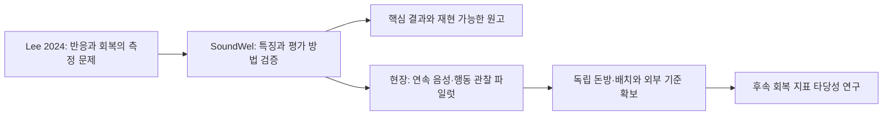

**SoundWel 검증 → 원고 → 음성·행동 후속 연구 가이드맵**

**2026-10-16 현재 우선순위:** [전체 실험과 데이터 수집 계획](data_collection_master_plan.md)과 [8주 커리큘럼](../curriculum.md)을 따른다. SoundWel은 [10월 12일 맥락 전이 실험](context_transfer_design.md), 농장은 두 인접 돈방의 Tapo 내장 음성·SD 수집을 병행한다. 아래 10월 8일 연구 프로그램은 배경과 이전 계획이며, 현재 H1/H2·일정·수집 규칙을 덮어쓰지 않는다. 현장 수집은 첫 원고의 완료 조건이 아니다.

[시작](../README.md) · [커리큘럼](../curriculum.md) · [실행 명세](soundwel_execution.md) · [Lee 2024 연결](lee2024_bridge.md) · [진도](../progress.md)

2026-10-08. 가장 빠른 경로는 **공개자료의 작은 비교를 끝내면서 Methods와 그림을 동시에 만드는 것**이다. 조직·RNA·세포배양 전 과정을 선행 조건으로 두지 않는다. 지금 필요한 지식은 실험 단위, 음향 특징, 그룹 평가, 반복 측정과 불확실성, 행동 관찰의 정의다.

추천 연구 프로그램은 **“돼지의 반응과 회복을 관찰하기 위한 음향 측정의 검증과 연속 음영상 수집”**이다. [Lee 2024](https://doi.org/10.1016/j.applanim.2024.106243)는 생물학적 동기이며, SoundWel로 회복탄력성을 검증할 수 있다는 뜻은 아니다.

**수정한 우선순위.** 기존 연간 계획은 [보관본](roadmap_2026-10-01.md)에 남겼다.

| 기존 배치 | 이번 변경 | 즉시 산출물 |
|---|---|---|
| 조직·분자 기법을 먼저 넓게 학습 | 음향 데이터·그룹·통계를 첫 주로 이동 | 질문 1쪽, 데이터 단위·결측 표 |
| 모델 실험 뒤 원고 작성 | 배정된 집필 시간 안에서 매일 Methods·그림 갱신 | Methods → 표·그림 → Results |
| 리뷰·음향·조직 세 편 병렬 추진 | 당장은 음향 방법 검증 원고가 주력 | 한 질문 집합을 끝내는 집중도 |
| 새 모델 확대 | 지속시간과 소수 특징부터 비교 | 해석 가능한 기준·실패 조건 |
| 놀람시험과 직접 연결 | 반응·회복 구분과 반복 관찰 설계로 연결 | ethogram·동기화·사건 기록 SOP |

기존 조직·분자 실험 의무와 확보된 시료는 별도 연구 블록에서 유지한다. P1 리뷰와 P3 조직 원고는 확보된 증거를 정리하되, 이번 8주에 세 편을 모두 완성할 목표는 두지 않는다.

**2026-10-12 현재 첫 원고:** [맥락 전이 프로토콜](context_transfer_design.md)의 H1 학습 맥락 차이와 H2 특징 추가 효과를 우선한다. 동복 제외 5-fold·20회 기본 분석이며 현장 수집은 필수 조건이 아니다. 아래 세 질문·일정은 이전 계획의 이력이고 현재 구체적 순서는 새 프로토콜과 개정 커리큘럼을 따른다.

**이전 첫 원고의 세 질문.** 가제: *Context-associated acoustic features in pig vocalisations: sensitivity to grouping and evaluation design in SoundWel.*

| 질문 | 최소 비교 | 보고할 것 |
|---|---|---|
| H1. LF 지속시간 차이는 반복 구조를 처리해도 유지되는가? | 적격 팀 내 맥락 대비, 개체/쌍을 반영한 추정 | 방향·효과·CI, 검정 불가 조건 |
| H2. 다른 특징은 지속시간보다 정보를 더 주는가? | 동일 표본·분할의 Dur vs Dur+AMRate+Q50+entropy | 성능 차이·불확실성·결측 민감도 |
| H3. 평가 단위가 바뀌면 결론도 달라지는가? | 콜 무작위 vs 확인된 개체/쌍 분리; 적격 팀 제외 평가 | 비교 가능한 평가 집단, 이동 조건·적용 범위 |

H1~H3은 본문 구성 질문이다. 기존 30개 가설을 지우거나 유리한 검정만 골라 다중검정 범위를 줄이지 않는다. 이미 본 결과와 탐색 이력을 공개하고 이번 계획을 결과를 보지 않은 사전등록이라고 부르지 않는다. [실행 명세](soundwel_execution.md)에서 추정·분할·결측·FDR 결정을 먼저 고정한다.

H2/H3의 1차 표본은 적격 LF 콜이며 예측 대상은 맥락 기반 assumed valence(Pos/Neg)다. 17개 맥락 다중분류와 구분한다. 첫 2주는 작은 적격 집합의 방법·출력을 검증하고, 3~4주에 범위를 고정한 핵심 분석을 완성한다.

**속도와 완료 기준.** 주 60h 중 분석 24h, 생물학·통계 8h, 집필·원문·회의 10h, 기존 실험·현장 준비 10h, 논술 8h다. 주차는 실제 시작일부터 계산한다. 자료 접근이나 ID 복원이 늦으면 일정도 이동한다.

| 기간 | 실험·학습 | 집필 산출물 | 통과 기준 / 미달 시 대응 |
|---|---|---|---|
| 첫 72시간 | Lee/Briefer 개념 비교, ID·쌍·라벨·결측 감사 | 질문·자료·분석 단위 Methods | 원본 ID 의미 추적. 불명확한 그룹의 개체 일반화 보류 |
| 1주 | 표본·적격 비교 확인, 최소 기준 모델 준비 | 데이터 흐름·Table 1 틀 | 결합으로 행이 임의 증가하거나 그룹이 겹치지 않음 |
| 2주 | 분할·전처리 고정, 최소 H1~H3 실행 또는 불가 근거 정리 | Methods v1·검증 패키지 | 과학적으로 타당한 입력·비교 확인. 실행 성공만으로 통과하지 않음 |
| 3~4주 | 반복 구조·결측·맥락·누출 민감도와 CI | 핵심 결과·Results v1 | 새 기여가 남는지 판단. 부족하면 기술 보고서/추가 자료 설계로 범위 조정 |
| 5주 | 필요할 때만 동결 표현 비교 | 추가 비교·오류 사례 | PANNs 우선. Perch 2는 환경·예산 확인 후 선택 1개, 필수 아님 |
| 6주 | 결과 재생성, 현장 동기화·라벨 SOP | Introduction·Discussion 포함 초안 | 표·그림·서술의 숫자와 표본 수 일치 |
| 7주 | 다른 세션/사람의 재실행, 내부 검토 | 완성 초안·재현 설명서 | 주요 결론 재현, 미해결 한계를 주장에 반영 |
| 8주 | 공동저자 수정·저널 적합성·공개 범위 점검 | 투고 준비본 또는 수정 계획 | 기여·분석·저자 검토 충족 후 투고. 미달이면 날짜 이동 |

2주는 **작동하고 설명 가능한 최소 분석**, 4주는 **핵심 결과를 판단할 시점**, 6~8주는 **원고 검토와 투고 준비 목표**다. 심사 기간과 게재 여부는 포함하지 않는다. 분석이 일찍 끝나면 집필을 앞당기되 검증 항목을 삭제하지 않는다.

**연구 가치는 조건부로 있다.** 그룹 분할이나 모델 하나의 높은 점수만으로 새 기여가 생기지는 않는다. 특징 효과가 어디까지 유지되는지, 결측·녹음 조건·평가 단위가 어떤 결론을 바꾸는지, 후속 관찰에 어떤 측정이 부족한지를 재현 가능한 분석으로 보여줘야 한다. 차이가 작거나 반대여도 불확실성과 적용 범위를 보고한다. 4주차에는 추가 모델보다 이 기여가 확보됐는지 먼저 판단한다. [최근 연구와 중복 점검](../references/soundwel_resilience.md).

**현장 준비는 병행하되 첫 원고의 필수 데이터로 묶지 않는다.** 현재는 CON/TRT 두 인접 돈방을 관찰하는 측정 파일럿이다. 처리별 돈방이 하나이므로 시간 구간·발성 수·재실 두수가 독립 처리 반복을 대신하지 않는다. 최신 장비·기록·판독·보존 규칙은 [전체 수집 계획](data_collection_master_plan.md)에 있다. 보상성장과 회복탄력성은 같은 라벨이 아니다. [후속 변수·가설](lee2024_bridge.md).

매주 실제 실행 증거로 [진도](../progress.md)를 갱신한다. 숫자가 없는 부분은 빈칸으로 남기고 다음 실행 전에 한 질문·한 비교·한 산출물을 정한다. 토요일에는 [주간 점검](../templates/research-weekly-checkpoint.md)으로 분석과 집필을 함께 검토한다.
